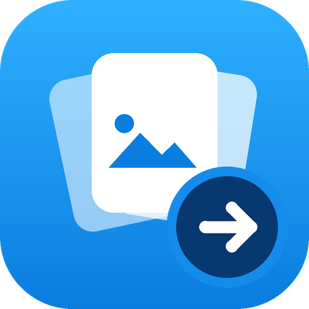
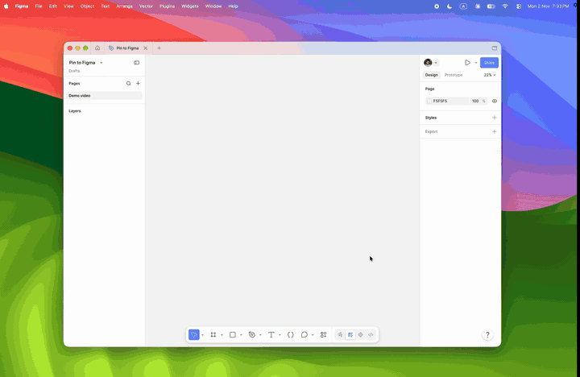

# Pin to Figma





[Watch the 33 second demo with captions](docs/demo.mp4)

Click a pin on Pinterest, and the image lands on your Figma canvas. No more copy and paste, one image at a time.

- Adds a **→ Figma** button on every Pinterest pin
- Sends the full-size original, not the thumbnail
- Pins line up in neat rows at one height, top aligned, and wrap to a new row
- Free, open source, everything runs on your own computer

Made by [@madebymujakkir](https://x.com/madebymujakkir) on X.

## Easiest setup: let Claude Code do it

If you use [Claude Code](https://claude.com/claude-code) (or the Code tab in the Claude desktop app), open it and say:

> Clone `https://github.com/mujakkirhussen/pin2figma` and set it up. Follow SETUP.md.

It detects macOS or Windows, checks Python, starts the server, and tells you the two clicks
it cannot do for you (loading the extension in Chrome and importing the plugin in Figma).

## Manual setup

You need: **Chrome**, the **Figma desktop app**, and **Python 3**.

1. **Download** this repo (green *Code* button → *Download ZIP*), unzip it, and keep the folder somewhere permanent, like your home folder.
2. **Start the server** (it also starts at every login):
   - macOS: open Terminal and run `bash install.sh` inside the folder.
   - Windows: double-click `install-windows.bat`. Install Python first from python.org and tick *Add python.exe to PATH*.
3. **Chrome extension:** open `chrome://extensions`, turn on *Developer mode*, click *Load unpacked*, choose the `extension` folder.
4. **Figma plugin:** in the Figma desktop app, open a design file, then *Plugins → Development → Import plugin from manifest…* and choose `figma-plugin/manifest.json`. Run *Pin to Figma* and keep its small window open.

## Use it

1. Open the plugin in Figma (keep its window open).
2. On pinterest.com, hover a pin and click the blue **→ Figma** button at its bottom-left.
3. The image appears on the canvas.

## How it works

```
Pinterest page ──▶ Chrome extension ──▶ local server (127.0.0.1:3737) ──▶ Figma plugin ──▶ canvas
```

The extension finds the original image link of the pin. The tiny Python server downloads that image and hands it to the plugin, which places it in Figma. Nothing is sent anywhere except the normal download of the image from Pinterest's image servers. No accounts, no tracking.

## Troubleshooting

| Problem | Fix |
|---|---|
| Button says **Server off** | The server is not running. Run `install.sh` / `install-windows.bat` again, or start it by hand: `python3 server/server.py` |
| Plugin window shows **Server off** | Same as above |
| Button says **Sent** but nothing appears | The Figma plugin window is closed. Open it again |
| No button on Pinterest | Reload the Pinterest tab after loading the extension |
| Windows asks about network access for Python | Choose **Allow** |

## Remove

macOS: `bash uninstall.sh`. Windows: run `uninstall-windows.bat`. Then remove the extension in `chrome://extensions` and the plugin in Figma.

## Please read

- Made for **personal inspiration and moodboards**. Images on Pinterest belong to their creators, so check the source before using them in client work or publishing them.
- Not affiliated with or endorsed by Pinterest or Figma.
- Pinterest can change its page layout, which may break the button. Open an issue if that happens.
- Windows scripts were written without a Windows machine to test on. Reports are welcome.

## License

[MIT](LICENSE)
